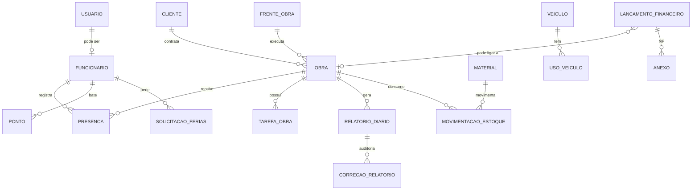

# L3 Telecom System — Modelo de Domínio

> Rascunho inicial baseado nos requisitos já definidos. Campos marcados com `?` ainda precisam ser confirmados.

## Diagrama de entidades

## Entidades

### Usuario
| Campo | Tipo | Observação |
|---|---|---|
| id | int | PK |
| email | texto | único |
| senha_hash | texto | nunca guardar senha pura |
| perfil | enum | `dono`, `coordenador`, `administrativo`, `rh` |
| ativo | bool | desativar em vez de apagar |
| funcionario_id | int? | vínculo opcional |

### Funcionario
id, nome, cpf?, cargo, setor, data_admissao, ativo, telefone_whatsapp?, foto?

### Cliente
id, nome, contato?, observacoes?

### FrenteObra
id, nome (as 8 frentes), responsavel_id → Funcionario, telefone_whatsapp (origem dos relatórios)

### Obra
| Campo | Observação |
|---|---|
| id, nome | |
| cliente_id | → Cliente |
| frente_id | → FrenteObra |
| endereco | |
| responsavel_id | → Funcionario |
| data_inicio, data_prevista_fim | |
| situacao | `planejada`, `em_andamento`, `pausada`, `concluida` |
| foto_capa | imagem do local |
| avanco_percentual | calculado a partir das tarefas |
| aviso_100_enviado | bool (evita e-mail duplicado) |

### TarefaObra (item de avanço)
id, obra_id, tipo_item (enum), descricao?, qtd_prevista, qtd_executada

Tipos: `unidade_remota`, `quadro_eletrico_via`, `cabo_optico_24fo`, `cabo_optico_12fo`,
`cto`, `cabo_fendido`, `suporte_cabo_fendido`.

Regra: `avanco = soma(qtd_executada) / soma(qtd_prevista)`. Ao chegar a 100%, enviar e-mail uma única vez.

### Presenca
id, funcionario_id, obra_id, data, observacao? — única por (funcionario, data).

### RelatorioDiario
| Campo | Observação |
|---|---|
| id, obra_id?, frente_id | |
| mensagem_original | **imutável**, sempre preservada |
| recebido_em, remetente_telefone | |
| inicio, termino, local | extraídos pela IA |
| presentes, fiscal | |
| servicos_executados, servicos_nao_executados | |
| pendencias, justificativas | |
| status | `completo`, `incompleto`, `necessita_revisao` |
| campos_faltantes | lista do que a IA não encontrou |
| revisado_por, revisado_em | |

Regra: a IA **não inventa dados**; o que não estiver na mensagem fica vazio e entra em `campos_faltantes`.

### CorrecaoRelatorio (auditoria)
id, relatorio_id, campo, valor_anterior, valor_novo, usuario_id, data_hora.

### Ponto
id, funcionario_id, data_hora, tipo (`entrada`, `saida`, ...)

### SolicitacaoFerias
id, funcionario_id, data_inicio, data_fim, status (`pendente`, `aprovada`, `recusada`), aprovado_por?

### Aviso
id, titulo, mensagem, criado_por, publico_alvo?, criado_em

### Material / MovimentacaoEstoque
- Material: id, nome, unidade, estoque_minimo?
- Movimentação: id, material_id, tipo (`entrada`, `saida`), quantidade, obra_id?, data, usuario_id

### Veiculo / UsoVeiculo
- Veiculo: id, placa, modelo, ativo
- UsoVeiculo: id, veiculo_id, funcionario_id?, obra_id?, data, km?, observacao? *(campos a confirmar)*

### LancamentoFinanceiro
id, tipo (`entrada`, `gasto`), valor, data, categoria, descricao, obra_id?, lancado_por, **anexos** (NF).

## Matriz de acesso
| Módulo | Dono | Coordenador | Administrativo | RH |
|---|:-:|:-:|:-:|:-:|
| Dashboard geral | ✅ | ✅ (filtrado) | ✅ (filtrado) | ✅ (filtrado) |
| Funcionários / Presença | ✅ | ✅ | ✅ | ✅ |
| RH (ponto, férias, avisos) | ✅ | ✅ | ❌ | ✅ |
| Obras e relatórios | ✅ | ✅ | ✅ (corrige relatórios) | ❌ |
| Estoque | ✅ | ? | ✅ | ❌ |
| Frotas | ✅ | ? | ✅ | ❌ |
| Financeiro (ver) | ✅ | ❌ | ❌ | ❌ |
| Financeiro (lançar gastos) | ✅ | ❌ | ✅ | ❌ |

> Os `?` são sugestões a confirmar; a matriz de Funcionários/Presença e Estoque/Frotas ainda não foi definida por você.

## Regras de negócio principais
1. Nunca apagar registros; usar `ativo = false`.
2. Mensagem original do WhatsApp é imutável; correções geram `CorrecaoRelatorio`.
3. E-mail de obra 100% é enviado uma única vez.
4. Dashboard sempre filtrado pelo perfil do usuário.
5. Senhas guardadas apenas como hash.